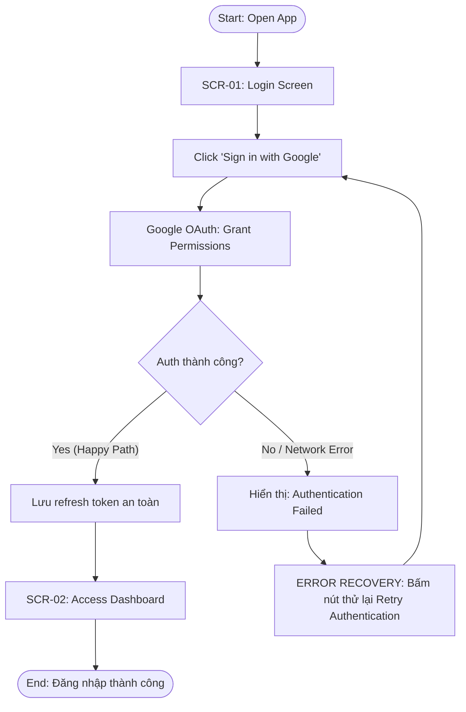
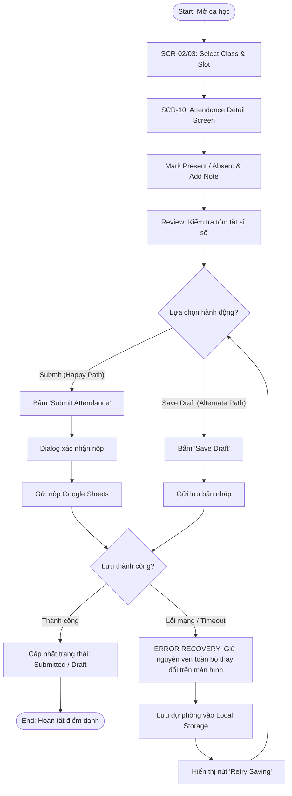
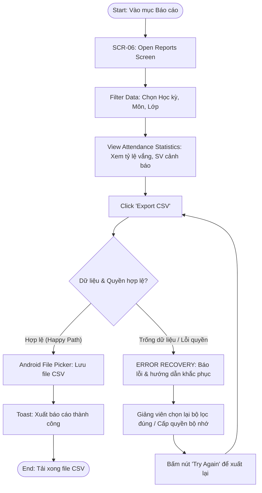

# 04. USER FLOWS

**Dự án:** AttendEase - FPT Academic Attendance & Sync Portal (PRM393 - Lab 2 Android App)  
**Minh chứng phục vụ:** Slide 03 (Information Architecture) & Slide 04 (Three User Flows)  
**Tài liệu tham chiếu Figma:** Figma 01

---

## TỔNG QUAN 3 USER FLOWS (THEO QUY CHUẨN ĐỀ BÀI)

### 1. Authentication
`Open App → Sign in with Google → Grant Permissions → Access Dashboard`

### 2. Take Attendance
`Select Class → Mark Present/Absent → Review → Save Draft / Submit`

### 3. View Reports
`Open Reports → Filter Data → View Attendance Statistics → Export CSV`

---

### Error Recovery
- **Login:** Retry authentication.
- **Attendance:** Retry saving without losing current changes.
- **Reports:** Fix export errors and try again.

---

## CHI TIẾT CÁC FLOW (START → GOAL → END & SƠ ĐỒ MERMAID)

### 1. Flow 1: Authentication Flow
* **Bắt đầu (Start):** Giảng viên mở ứng dụng AttendEase trên điện thoại.
* **Mục tiêu (Goal):** Xác thực tài khoản Google trường FPT (@fpt.edu.vn) và cấp quyền truy cập Google Sheets.
* **Kết thúc (End):** Vào thành công màn hình Dashboard chính (`/home`).
* **Happy Path:**
  1. Mở ứng dụng (`/login`).
  2. Bấm nút **"Sign in with Google"**.
  3. Trình duyệt mở ra $\rightarrow$ Giảng viên cấp quyền đọc/ghi Google Sheets (Grant Permissions).
  4. Ứng dụng nhận OAuth code qua loopback server và kích hoạt `AppLifecycleListener` để hoàn tất đăng nhập.
  5. Điều hướng thẳng vào **Dashboard** (`/home`).
* **Error & Recovery (Login):**
  - **Lỗi phát sinh:** Mất mạng khi đang ủy quyền, hoặc đóng Chrome giữa chừng làm gián đoạn luồng OAuth.
  - **Cơ chế phục hồi (Retry authentication):** Ứng dụng bắt ngoại lệ, hiển thị dòng thông báo lỗi rõ ràng bên dưới nút đăng nhập kèm trạng thái sẵn sàng để giảng viên bấm **Retry authentication** (Thử đăng nhập lại) ngay lập tức mà không cần khởi động lại app.

---

### 2. Flow 2: Take Attendance Flow
* **Bắt đầu (Start):** Giảng viên mở ca học từ Dashboard hoặc Session Browser.
* **Mục tiêu (Goal):** Điểm danh chính xác sinh viên của lớp, có thể Lưu nháp (Save Draft) hoặc Nộp chính thức (Submit).
* **Kết thúc (End):** Dữ liệu được ghi nhận vào hệ thống Google Sheets (`attendance`), trạng thái ca chuyển sang hoàn tất.
* **Happy Path (Nộp chính thức):**
  1. Chọn lớp/ca học cần điểm danh (`Select Class`).
  2. Mở danh sách sinh viên (`AttendanceDetailPage`).
  3. Đánh dấu Có mặt/Vắng mặt (`Mark Present/Absent`) kèm ghi chú lý do.
  4. Xem lại tóm tắt sĩ số Có mặt/Vắng mặt (`Review`).
  5. Bấm **"Submit"** $\rightarrow$ Xác nhận $\rightarrow$ Dữ liệu được lưu lên Google Sheets.
* **Alternate Path (Lưu nháp):**
  - Giảng viên đang điểm danh nhưng chưa hết giờ hoặc muốn bổ sung sau $\rightarrow$ Bấm **"Save Draft"** $\rightarrow$ Bản ghi được lưu tạm với cờ nháp (Draft) mà không chốt nộp.
* **Error & Recovery (Attendance):**
  - **Lỗi phát sinh:** Đang bấm Save Draft hoặc Submit thì mất kết nối mạng Wi-Fi/4G hoặc Google Sheets timeout.
  - **Cơ chế phục hồi (Retry saving without losing current changes):**
    - Ứng dụng **giữ nguyên 100% các tích chọn và ghi chú hiện tại trên màn hình** (không reset, không mất dữ liệu).
    - Tự động cache bản nháp tạm vào bộ nhớ máy (`shared_preferences`).
    - Hiển thị thông báo lỗi mạng kèm nút **"Retry Saving"** để giảng viên bấm thử lưu lại ngay khi kết nối ổn định.

---

### 3. Flow 3: View Reports Flow
* **Bắt đầu (Start):** Giảng viên truy cập mục Báo cáo từ thanh điều hướng.
* **Mục tiêu (Goal):** Lọc dữ liệu chuyên cần theo lớp/kỳ học, theo dõi tỷ lệ vắng và xuất báo cáo ra tệp CSV.
* **Kết thúc (End):** Tệp CSV được tạo thành công và lưu vào bộ nhớ thiết bị Android qua File Picker.
* **Happy Path:**
  1. Mở trang Báo cáo (`Open Reports` - `/reports`).
  2. Chọn bộ lọc: Học kỳ, Mã môn, Lớp học (`Filter Data`).
  3. Quan sát các chỉ số thống kê vắng mặt và danh sách sinh viên cảnh báo (`View Attendance Statistics`).
  4. Bấm **"Export CSV"** $\rightarrow$ Hệ thống xuất tệp dữ liệu điểm danh.
* **Error & Recovery (Reports):**
  - **Lỗi phát sinh:** Lớp học chưa có dữ liệu điểm danh (tập rỗng) hoặc lỗi quyền ghi tệp/bộ nhớ trên Android.
  - **Cơ chế phục hồi (Fix export errors and try again):**
    - Ứng dụng hiển thị hộp thoại thông báo nguyên nhân cụ thể: *"Chưa có buổi học nào được điểm danh trong bộ lọc này"* hoặc *"Không thể mở thư mục lưu trữ"*.
    - Hướng dẫn giảng viên chọn lại khoảng thời gian/lớp học hợp lệ hoặc cấp lại quyền lưu tệp di động (`FileService.saveTextFile`).
    - Nút **"Try Again"** cho phép thử xuất lại ngay sau khi sửa bộ lọc.

---

## BẢNG ÁNH XẠ FLOW ↔ SCREEN ↔ ERROR RECOVERY

| User Flow | Chuỗi bước (Step-by-Step Flow) | Màn hình tương ứng (Screen ID) | Tình huống lỗi phát sinh | Cơ chế phục hồi (Error Recovery) |
| :--- | :--- | :--- | :--- | :--- |
| **1. Authentication** | `Open App → Sign in with Google → Grant Permissions → Access Dashboard` | `SCR-01` (`/login`) $\rightarrow$ Google OAuth $\rightarrow$ `SCR-02` (`/home`) | Đứt kết nối mạng khi cấp quyền; lỗi loopback server trên Android. | **Retry authentication:** Giữ trạng thái, hiển thị thông báo lỗi và nút thử đăng nhập lại ngay lập tức. |
| **2. Take Attendance** | `Select Class → Mark Present/Absent → Review → Save Draft / Submit` | `SCR-02/03` $\rightarrow$ `SCR-10` (`/attendance/:sessionId`) | Rớt mạng Wi-Fi khi bấm nộp; Google Sheets API trả về mã lỗi 503/timeout. | **Retry saving without losing current changes:** Giữ nguyên 100% thay đổi trên UI, backup tạm vào local storage, cung cấp nút "Retry Saving". |
| **3. View Reports** | `Open Reports → Filter Data → View Attendance Statistics → Export CSV` | `SCR-06` (`/reports`) / `SCR-07` (`/fap-sync`) | Bộ lọc rỗng (không có dữ liệu điểm danh); lỗi không mở được file picker trên thiết bị. | **Fix export errors and try again:** Thông báo lý do rõ ràng, hướng dẫn điều chỉnh bộ lọc lớp/kỳ học và cung cấp nút "Try Again". |
